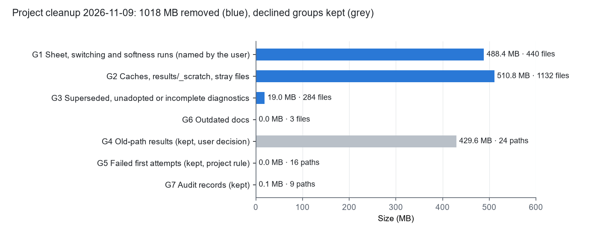
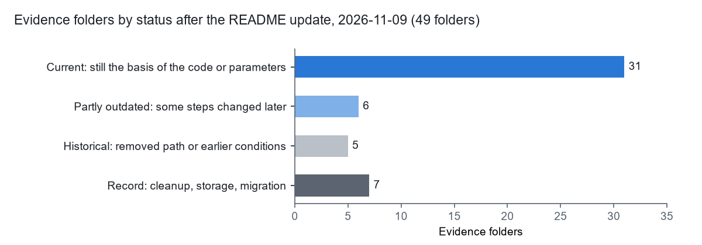

# 工程清理：过时、无用、不完整的诊断与运行（2026-11-09，用户批准后执行）

**用户要求（2026-11-09）：**
1. 删除分步换场、2.5 MHz 软硬对比、竖片转动、竖片平移/弯曲/线→点、竖片起点的复杂变化这 5 项的结果和数据。原因："分步换场雕刻"在模型里行不通，后来改为让声场连续变化；从竖片出发对后续试验没有意义。
2. 清理 `evidence/` 中过时、无用、不完整的诊断和运行内容，同步删除 `results/` 中对应的数据。
3. 清理整个工程中过时、无用的代码、文档、日志。

**做法：** 先核对用途，再把精确路径清单交给用户批准（`CLEANUP_PROPOSAL_20261109.md`）。用户的批准是：

| 组 | 内容 | 用户决定 |
|---|---|---|
| G1 | 上面点名的 5 项（含 shape3d、complex_ball 里与竖片对比的图和数据） | 删除 |
| G2 | 不再使用的编译缓存、qpOASES 库、`__pycache__`、`.pytest_cache`、`.ruff_cache`、`results/_scratch/`、空目录 `results/regression_v1`、根目录散落的 `node_probe_1e-08.json` | 删除 |
| G3 | 已被取代、未采用或不完整的 17 个诊断目录和 2 个已标为过时的子目录 | 删除 |
| 代码 | 没有任何地方调用的 6 个函数 | 删除 |
| G6 | `docs/TREE.txt`、`docs/DELIVERY_REPORT.md`、`HANDOFF_20261102.md` | 删除 |
| G4 | HF/LF 路径和旧配置写法的结果，以及两个旧可视化目录（430 MB） | **保留**（维持 11-06 "数据和证据全部保留"的决定） |
| G5 | 失败的首次尝试（16 项） | **保留**（项目规则"保留失败证据"） |
| G7 | 10 月迁移、清理、同步的审批记录 | **保留** |

## 删除了什么

- 共 1859 个文件，约 1018 MB（`data/DELETED_FILES.json`，删除前逐个记下了路径、大小和 SHA-256）。
- 其中 58 个文件被 Git 跟踪，可以从 Git 历史恢复；其余文件（包括 `results/` 里的运行）不在 Git 里，删除后无法恢复。服务器上的副本没有动。
- `evidence/` 从 67 个目录减到 48 个（加上本目录共 49 个）；`build/` 只留当前代码在用的 3 份编译缓存（apecss `16b0195e2dc6a2d9`、contact `7693fe3fc4a409bd`、pair_forces `acf33178214f8551`）。
- G1 中包括 `results/rotate_20261108/first_attempt_sum_mismatch/` 和 `results/morph_20261108/first_attempt_cap_rounding/` 里的 `MOV_*`：它们是被点名删除的竖片运行的首次尝试，随这些运行一起删除。G5 只保留与现存运行对应的首次尝试。
- 删除的 6 个函数：`geometry.CylindricalLumen.contains`、`PDMSCavity.labels`、`PDMSCavity.boundary_labels`、`PDMSCavity.project`、`initial_conditions.list_states`、`analysis.series`。删除前在 `microbubble/`、`workflows/`、`tests/`、`visualization/` 和 `main.py` 中逐一核对过，没有任何调用。

## 配套修改

- **引用标注：** 代码注释、`configs/pretrain_policy.json` 的说明、`README.md`、`docs/VALIDATION.md`、`docs/MODEL_AND_CALLFLOW.md`、`docs/PROGRESS_REPORT_20261108.md` 中引用被删路径的 43 行，在路径后加了"（2026-11-09 按用户要求删除）"或 "(deleted 2026-11-09, user decision)"，原文不变（`data/ANNOTATED_LINES.txt`）。`morph_sheet_20261108` 只删了第 1 部分，指向竖片变化的引用标为"第 1 部分已删除"，指向弱粘附部分的引用不变。
- **证据目录说明：** `sculpt_4pzt_20261108`、`morph_sheet_20261108`、`shape3d_20261109`、`complex_ball_20261109`、`run_storage_20261109`、`random_starts_20261106`、`apecss_harmonics_20261103` 的 README 开头各加了一段说明删了什么，正文不变。
- **没有改动的引用：** 另外 18 份保留下来的证据 README 在正文里提到了被删目录（`data/KEPT_EVIDENCE_REFERENCING_DELETED.json`）。它们是当时的记录，没有改。

## 验证

| 检查 | 结果 |
|---|---|
| `python main.py check` | PASS（`data/MAIN_CHECK.json`） |
| 全部测试（`APECSS_DIR`、`DAQP_DIR` 已设，含 GPU 和 APECSS） | 62 项中 61 项通过（`data/PYTEST.log`）。未通过的是 `test_irregular_clusters_are_connected_disordered_and_never_overwritten`：服务器生成的初态与本机重新生成的相差 1.2e-20 m，删除前就是这样，与本次无关 |
| 编译缓存 | 测试期间没有生成新的缓存目录，说明保留的 3 份正是当前代码在用的 |
| 保留项 | G4、G5、G7 的全部路径都在；`results/retained_history/`、`inputs/`、`evidence/migration/`、球团起点 `results/ball3d_20261109/start/` 及其来源运行都在 |

## 后续：更新工程内所有 README（同日，用户要求）

- **根目录 `README.md`：**
  - 改正过时的内容：频率范围 0.5–10 MHz；Y 形通道芯片上的初态位置和图样参考点；停止条件；当前分支和未提交状态。
  - 去掉指向已删目录和文档的链接，保留其中的结论和数字。
  - 新增"证据目录索引"，把 49 个证据目录按内容分组，并标出状态（现行 / 部分过时 / 历史 / 记录）。
- **证据目录和 `visualization/ab_protocol_sim/` 的 43 个 README：**
  - 标题下各加一行"状态（2026-11-09 核对）"，说明现在是否仍是现行依据、后来改了什么。
  - 正文里指向已删路径的 36 行加了"（2026-11-09 按用户要求删除）"（`data/README_UPDATE_LINES.txt`）。
  - 正文是当时的记录，没有改写。
- **改正一处笔误：** `lowfreq_20261109` 写的失败日志位置，实际在 `logs/failed_cap_rounding/`。
- **docs/ 的三份现行文档（同日稍后，用户要求）：**
  - `MODEL_AND_CALLFLOW.md`：新增"芯片"一节；方片声场、积分点数、Y 形通道的初态和离壁间隙、0.5–10 MHz、粘附间隙按两泡半径之和等改为现状；去掉指向已删证据的链接。
  - `DATA_STATUS.md`：新增"芯片文件"和"运行结果的保存"两节。
  - `VALIDATION.md`：开头加状态说明，补上 2026-11-09 的六次验证记录。
- **检查：**
  - 45 个 README 的 Markdown 链接全部有效；
  - 根目录索引覆盖全部证据目录；
  - 反引号里仍指向不存在路径的引用，都是原文已说明在 11-06 删除的文件、别的工程的路径或测试名。

## 文件

| 文件 | 内容 |
|---|---|
| `CLEANUP_PROPOSAL_20261109.md` | 交给用户批准的提案和逐条路径表 |
| `data/DELETE_LIST.json` | 各组的精确路径、大小、Git 跟踪文件数（含保留的 G4、G5、G7） |
| `data/DELETED_FILES.json` | 实际删除的每个文件的路径、大小、SHA-256 |
| `data/ANNOTATED_LINES.txt` | 加了删除标注的每一行 |
| `data/KEPT_EVIDENCE_REFERENCING_DELETED.json` | 正文仍提到被删目录的证据 README |
| `data/MAIN_CHECK.json`、`data/PYTEST.log` | 验证输出 |
| `data/README_UPDATE_LINES.txt` | README 更新时加了删除标注的每一行 |
| `*.py.txt` | 生成清单、执行删除、加标注、更新 README、作图的脚本 |
| `fig_cleanup.png` | 各组删除或保留的大小 |
| `fig_evidence_status.png` | README 更新后各状态的证据目录数 |
