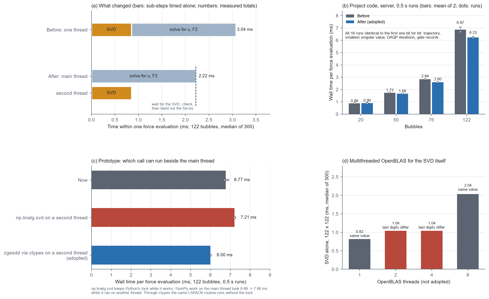

# 联立求解的最小奇异值检查放到第二个线程（2026-11-07）

> **状态（2026-11-09 核对）：** 部分过时。在第二个线程上经 ctypes 调用 `zgesdd` 算最小奇异值仍是现行做法；等结果的位置后来推迟到接触步之后，见 `evidence/svd_defer_20261107/`。

用户决定（2026-11-07）：不换检查的算法，只让它和 F2 同时算。

`EXPLORATORY / PRETRAIN_TIER`

> 后续（2026-11-07，用户决定）：等检查结果的位置从 `CPUForces.__call__` 的末尾推迟到积分循环里接触步之后，方程改用经 ctypes 调用的 `zgesv` 求解，见 `evidence/svd_defer_20261107/`。下面是做这次改动时的情况。

## 改了什么

联立求解（`forces.collective_fundamental`）每次都要算 M = I + χK 的最小奇异值，低于 `singular_guard`（1e-3）时整条运行停下，不做正则化。122 泡时这一步约 0.85 ms，约占力计算的八分之一。它的结果只在交出这次的力之前才需要，解方程、F2、F1、粘附力都用不到它。

**现在**（`microbubble/forces.py`）：
1. M 建好后，最小奇异值交给第二个线程（`smallest_singular_value`），主线程接着解方程、算 F2、F1、粘附力（122 泡时约 2.2 ms）。
2. `CPUForces.__call__` 在交出力之前等第二个线程算完。低于 `singular_guard` 时在这里报同样的错，这次的力不交出去，泡不会被推动。运行仍停在同一次力计算、同一个状态。
3. 检查本身没有变：同一个 LAPACK 函数 `zgesdd`（`np.linalg.svd(M, compute_uv=False)` 调用的就是它，在 NumPy 自带的 OpenBLAS 里），同样只求奇异值，M 同样按列存放，同一个阈值。122 个奇异值与 `np.linalg.svd` 逐位相同。

**为什么要经 ctypes 调用：** Python 有一把全局锁，同一时刻只有拿着锁的线程能执行 Python 代码。C 写的计算可以在算的时候放开这把锁，`np.linalg.svd` 却整个计算期间都不放（`data/GIL_PROBE.json`：另一个线程在跑 `np.linalg.svd` 时，主线程的 NumPy 运算从 6.68 ms 变成 7.66 ms）。所以把 `np.linalg.svd` 放到第二个线程，主线程照样得等。第一版原型就是这样，反而慢了（`fig1` (c)）。ctypes 调用 C 函数期间会放开这把锁，所以经 ctypes 调用同一个 `zgesdd`，它才能和主线程同时算。

**代价：**
- 依赖 NumPy 自带 OpenBLAS 的文件名（`numpy.libs/libscipy_openblas64_*.so`）和函数名（`scipy_LAPACKE_zgesdd64_`）。笔记本和服务器都是 NumPy 2.2.6（`pyproject.toml` 固定），升级 NumPy 时要核对这两个名字。
- 每次力计算多占一个 CPU 核约 0.85 ms。这时 APECSS 的线程空闲，服务器有 16 核。
- 万一触发停止，`exception.txt` 里的报错位置是 `CPUForces.__call__` 的末尾，不再是 `collective_fundamental`。

## 结果

**整条运行**（服务器，项目代码，4 个三维随机初态，1 ms，0.5 s，默认设置；改动前后各跑两次，`data/SVD_RUNS.json`，`fig1` (b)）：

| 泡数 | 每次力计算：改动前 | 改动后 | 整条运行：改动前 | 改动后 |
|---|---|---|---|---|
| 20 | 0.88 / 0.88 ms | 0.92 / 0.88 ms | 0.97 / 0.95 s | 1.02 / 0.95 s |
| 50 | 1.73 / 1.73 ms | 1.65 / 1.67 ms | 1.14 / 1.14 s | 1.11 / 1.11 s |
| 76 | 2.83 / 2.84 ms | 2.60 / 2.60 ms | 2.02 / 2.03 s | 1.91 / 1.92 s |
| 122 | 7.06 / 6.69 ms | **6.27 / 6.20 ms** | 5.59 / 5.38 s | **5.22 / 5.20 s** |

全部 16 条运行与第一条改动前的运行逐位相同：轨迹、记录的最小奇异值（`SUMMARY.json` 的 `min_collective_singular_value`）、DAQP 迭代总数和质量门记录都一样。122 泡时每次力计算省 0.4–0.9 ms（两次改动前的运行相差 0.37 ms，所以只能给出范围）；20 泡时矩阵只有 20×20，SVD 本来就很快，没有可省的。

**分项**（122 泡，第 250 次力计算的输入，各 300 次取中位数，`data/SVD_OVERLAP_CTYPES.json`，`fig1` (a)）：单算 SVD 0.85 ms；单算"解方程 + F2"2.22 ms；三步依次算 3.04 ms；SVD 放到第二个线程 2.22 ms，SVD 的时间完全被盖住。

**原型**（122 泡，0.5 s，`fig1` (c)）：
- `np.linalg.svd` 放到第二个线程（`data/SVD_OVERLAP_numpy_thread.json`）：每次力计算 6.82 / 6.89 → 7.22 / 7.20 ms，更慢。
- 经 ctypes 调用 `zgesdd`（`data/SVD_OVERLAP_CTYPES.json`）：6.69 / 6.69 → 5.98 / 6.02 ms。

两者的轨迹都与项目代码逐位相同。

**没有采用的：OpenBLAS 多线程算 SVD**（`data/SVD_OVERLAP_numpy_thread.json`，`fig1` (d)）：单独算一次 SVD，1、2、4、8 线程分别用 0.82、1.04、1.04、2.04 ms，2 和 4 线程时最小奇异值的末位还会变。122×122 的矩阵太小，分给多个线程，协调的开销比省下的多。

**测试：** 服务器 48/48 通过；笔记本 47/48，失败的仍是单层泡团文件的 AVX-512 末位差（改动前就失败）。新增测试 `test_singular_value_check_equals_numpy_svd`：经 ctypes 算出的最小奇异值必须与 `np.linalg.svd` 逐位相同。`python main.py check` 两边都通过。

## 文件

| 文件 | 内容 |
|---|---|
| `fig1_svd_overlap.png` | (a) 改动前后一次力计算的时间安排；(b) 项目代码的整条运行；(c) 原型：哪种调用能和主线程同时算；(d) OpenBLAS 多线程 |
| `data/SVD_RUNS.json`、`data/RUNS_{before,after}_{1,2}.json` | 项目代码改动前后的整条运行（`RUNS.py.txt`） |
| `data/SVD_OVERLAP_CTYPES.json` | 原型：经 ctypes 在第二个线程上算，含分项计时（`SVD_OVERLAP_CTYPES.py.txt`） |
| `data/SVD_OVERLAP_numpy_thread.json` | 原型第一版：`np.linalg.svd` 在第二个线程上算；OpenBLAS 多线程（`SVD_OVERLAP_numpy_thread.py.txt`） |
| `data/GIL_PROBE.json` | `np.linalg.svd` 是否放开 Python 的全局锁（`GIL_PROBE.py.txt` 的输出） |
| `FIGURE_SCRIPT.py.txt` | 作图脚本 |

服务器上的运行：`/workspace/scratch/collective_svd_overlap_20261107/`（项目代码前后各两次）、`/workspace/scratch/bottleneck_20261107/{svd_out,svd_ctypes_out}/`（两版原型）。改动前的 `forces.py` 和 `test_pretrain.py` 备份在服务器的 `/workspace/scratch/backup_20261107_before_svd_overlap/`。
