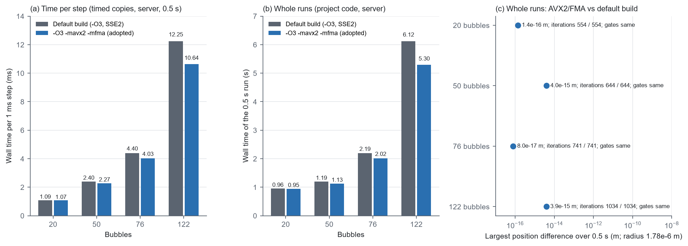

# 接触库改用 AVX2/FMA 编译（2026-11-07）

> **状态（2026-11-09 核对）：** 现行。

用户决定（2026-11-07）：采用接触库的 AVX2/FMA 编译。

`EXPLORATORY / PRETRAIN_TIER`

## 改了什么

`microbubble/contact.py` 的 `CONTACT_LIBRARY_FLAGS` 从 `-O3 -fPIC -shared` 改为 `-O3 -mavx2 -mfma -fPIC -shared`。接触库包括 `native/contact_step.cpp`、`native/daqp_qp.cpp` 和 DAQP 的 C 源码，C++ 接触步和 Python 接触步（`DaqpQP`）都用它。

- **AVX2**：一条指令同时算 4 个双精度数（默认编译只用 SSE2，一次 2 个）。
- **FMA**：a×b+c 一条指令完成，只舍入一次（默认是乘完舍入一次、加完再舍入一次）。

代价：
- 库只能在支持 AVX2 和 FMA 的 x86-64 CPU 上运行，大约 2013–2015 年以后的大多数桌面和服务器 CPU 都支持。笔记本 i7-13700HX、服务器 7950X 都支持。在不支持的 CPU 上，程序一执行到这种指令就以"非法指令"终止。
- 舍入的位置变了（乘加合成一步，求和分 4 路累加），结果与默认编译差在末位。误差大小不变，只是不再与以前的运行逐位相同。

编译选项是库缓存键（`cached_contact_library`）的一部分，所以两台机器各自新编译了一份，旧的缓存条目没有动。运行记录 `EXECUTION.json` 的 `identity.compiled_contact.command` 里能看到实际用的编译选项。

## 结果

**整条运行**（服务器，项目代码，4 个三维随机初态，1 ms，0.5 s，与默认编译比较，`data/AVX2_FMA_RUNS.json`，`fig1` (b)(c)）：

| 泡数 | 默认编译 | AVX2/FMA | 轨迹最大差 | 质量门记录 | DAQP 迭代总数 |
|---|---|---|---|---|---|
| 20 | 0.96 s | 0.95 s | 1.4e-16 m | 相同 | 554 / 554 |
| 50 | 1.19 s | 1.13 s | 4.0e-15 m | 相同 | 644 / 644 |
| 76 | 2.19 s | 2.02 s | 8.0e-17 m | 相同 | 741 / 741 |
| 122 | 6.12 s | **5.30 s** | 3.9e-15 m | 相同 | 1034 / 1034 |

轨迹差是舍入误差的大小（泡半径 1.78e-6 m），和整块装入改动前后的差一样大。

**每步耗时**（服务器，同一代码的两份计时副本，0.5 s 平均，`fig1` (a)；数据在 `evidence/daqp_block_warm_start_20261107/data/bill_block_seed*.json` 和 `bill_block_avx2_seed*.json`）：20/50/76/122 泡每步 1.09/2.40/4.40/12.25 ms → 1.07/2.27/4.03/10.64 ms。122 泡时省下的 1.6 ms 主要来自装入热启动（2.61 → 1.10 ms）。

**测试：** 服务器 47/47 通过。笔记本 46/47，失败的仍是单层泡团文件的 AVX-512 末位差，这项在改动前就失败，与接触库无关。`python main.py check` 两边都通过。

## 文件

| 文件 | 内容 |
|---|---|
| `fig1_avx2_fma.png` | (a) 每步耗时；(b) 整条运行用时；(c) 与默认编译的轨迹差 |
| `data/AVX2_FMA_RUNS.json` | 服务器整条运行的对比（含实际编译选项） |
| `FIGURE_SCRIPT.py.txt` | 作图脚本 |

服务器上的轨迹：`/workspace/scratch/qpoases_contact_20261106/{daqp_block_final,daqp_block_avx2}/`（默认编译、AVX2/FMA）。
