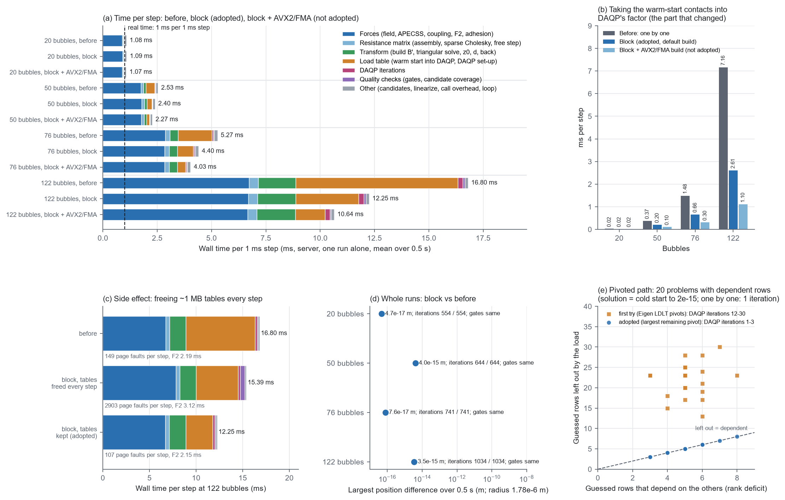

# DAQP 的热启动约束整块装入（2026-11-07）

> **状态（2026-11-09 核对）：** 现行。

用户要求（2026-11-07）：DAQP 每一步开始时的"装表"工作，计算内容不变，从"一个一个地算"改成"一整块一起算"：一次矩阵乘法算出表 G = M_A·M_Aᵀ，一次分块分解，冗余接触用选主元分解处理（主元≈0 的去掉），把分解交给 DAQP 照常迭代；用新旧代码逐步对比验证。

`EXPLORATORY / PRETRAIN_TIER`

## 改了什么

**原来：** 上一步贴紧的约 360 个泡对作为热启动交给 DAQP，DAQP 一个一个把它们加进工作集。每加一个，都要和已在工作集里的约束逐个做点积，再解一次三角方程。这些小运算一个接一个地做，122 泡时每步约 7.2 ms（`evidence/time_bill_20261107/`（2026-11-09 按用户要求删除））。

**现在**（`native/daqp_qp.cpp` 的 `load_warm_start`）：
1. 把这些约束行（DAQP 归一化后的 M 的行）抄成一块 M_A，一次矩阵乘法算出 G = M_A·M_Aᵀ。
2. 按原来的加入顺序对 G 做一次 Cholesky 分解（Eigen，原地）。如果每个主元都不小于 DAQP 的 `sing_tol`（3.7e-11），它就是 DAQP 一个一个加入时得到的那个分解。把它换算成 DAQP 的存法（单位下三角 L 和对角 D）直接写进 DAQP 的工作区。
3. 如果有主元小于 `sing_tol`（有接触依赖其余接触），改用选主元分解：每一步都取消元后剩下的最大主元，直到剩下的最大主元小于 `sing_tol`；剩下的就是依赖其余接触的约束，留在工作集外（乘子为 0）。DAQP 一个一个加入时也会跳过依赖的约束。
4. DAQP 从这个工作集照常迭代，迭代、容差、迭代上限、质量门都没变。

DAQP 的源码没有改：调用顺序照 DAQP 的 `daqp_quadprog`（建立 → 装入热启动 → 求解），只是建立时不再让 DAQP 自己加入热启动约束。

**内存：** M_A 和 G 在 122 泡时各约 1 MB，保留在两次调用之间，不每步重新申请。第一版每步申请再释放，结果 glibc 把堆顶内存还给系统，Python 侧的力计算随后的临时数组又要重新向系统要页面：122 泡时每步缺页从 149 次变成 2903 次，力 F2 从 2.2 ms 变成 3.1 ms，DAQP 建立也慢了约 0.4 ms。用 glibc 的环境变量 `MALLOC_MMAP_THRESHOLD_`/`MALLOC_TRIM_THRESHOLD_` 让它不还内存，这个副作用就消失（`data/malloc_*.json`），所以原因确定是内存申请，不是缓存。保留两张表之后，每步缺页 107 次，F2 回到 2.15 ms（`fig1` (c)）。

## 结果

**每步耗时**（服务器，单独一条运行，0.5 s 平均；计时副本见 `timed_sources/`，`fig1` (a)(b)）：

| 泡数 | 改动前每步 | 整块装入每步 | 其中装入热启动：前 → 后 | AVX2/FMA 编译（未采用） |
|---|---|---|---|---|
| 20 | 1.08 ms | 1.09 ms | 0.02 → 0.02 ms | 1.07 ms |
| 50 | 2.53 ms | 2.40 ms | 0.37 → 0.20 ms | 2.27 ms |
| 76 | 5.27 ms | 4.40 ms | 1.48 → 0.66 ms | 4.03 ms |
| 122 | 16.80 ms | **12.25 ms** | 7.16 → 2.61 ms | 10.64 ms |

122 泡时整块装入的 2.61 ms 里，矩阵乘法约占 2/3。

**整条运行**（服务器，4 个三维随机初态，1 ms，0.5 s，项目代码本身，`data/DAQP_BLOCK_RUNS.json`，`fig1` (d)）：

| 泡数 | 改动前 | 改动后 | 轨迹最大差 | 质量门记录 | DAQP 迭代总数 |
|---|---|---|---|---|---|
| 20 | 1.0 s | 1.0 s | 4.7e-17 m | 相同 | 554 / 554 |
| 50 | 1.3 s | 1.2 s | 4.0e-15 m | 相同 | 644 / 644 |
| 76 | 2.7 s | 2.2 s | 7.6e-17 m | 相同 | 741 / 741 |
| 122 | 8.5 s | **6.1 s** | 3.5e-15 m | 相同 | 1034 / 1034 |

轨迹差是舍入误差的大小（泡半径 1.78e-6 m）。这 4 条运行共 2000 次求解：各自的第一次没有热启动，其余 1996 次全部走第 2 步，没有一次走选主元分支（计时副本的计数）。

**选主元分支**（本机，`data/PIVOT_CHECK.json`，`fig1` (e)）：真实运行里没有遇到依赖的接触，所以专门构造了 20 个最小距离问题：30 个随机约束（40 维）外加 8 个依赖行（重复的行、两行的正组合）。热启动猜测把起作用的依赖行也标上。
- 留在工作集外的行数在 20 个问题里全部恰好等于依赖行数（猜测行数减去它们的秩）。
- 解与冷启动的差 ≤1.6e-15。
- DAQP 迭代：17 个问题 1 次，3 个问题 3 次。一个一个加入时都是 1 次；差别来自选出的那组独立接触不同，DAQP 要再换一两个。

测试里的全部接触步（受挤压的成形泡团 32/128 泡、三个几乎贴住的泡、记录下来的循环网络）新旧版本逐项相同，位置差 ≤5e-21 m，同样没有走到这一分支。

**第一版选主元的错误（已改）：** 第一版用 Eigen 的 `LDLT` 做选主元分解，但它按消元之前的对角元选主元（这里全是 1），选出的主元并不按大小排列，分不出依赖的行。结果多留出 13–30 行，DAQP 要多迭代 12–30 次才能把它们加回来（解仍然正确，`data/PIVOT_CHECK_first_try.json`）。现在按消元后剩下的主元选（与 LAPACK 的 `dpstrf` 相同）。新增的测试 `test_block_warm_start_leaves_out_dependent_contacts` 会抓住这种错误（第一版在这个测试里要 15 次迭代，测试要求 ≤3 次）。

**测试：** 服务器 47/47 通过；笔记本 46/47，失败的仍是单层泡团文件的 AVX-512 末位差。`python main.py check` 两边都通过。

## 没有采用的：AVX2/FMA 编译

> 后续：同日（2026-11-07）用户决定采用，见 `evidence/contact_avx2_fma_20261107/`。下面是做这次改动时的情况。

目前接触库用 `-O3` 编译，只用到 SSE2（一次算 2 个数）。加 `-mavx2 -mfma`（一次算 4 个数，乘加一步完成），122 泡每步从 12.25 ms 降到 10.64 ms，装入热启动从 2.61 ms 降到 1.10 ms。笔记本（i7-13700HX）和服务器（7950X）都支持。没有采用，原因有两个：只能在支持 AVX2/FMA 的 CPU 上运行；乘加合成一步会改变舍入，结果与现在的末位不同。是否采用由用户决定。

## 文件

| 文件 | 内容 |
|---|---|
| `fig1_block_warm_start.png` | (a) 每步耗时分项；(b) 装入热启动这一项；(c) 每步释放内存的副作用；(d) 整条运行的轨迹差；(e) 选主元分支 |
| `data/bill_before_seed*.json`、`data/bill_block_seed*.json`、`data/bill_block_avx2_seed*.json` | 改动前、整块装入、整块装入 + AVX2/FMA 的耗时账单（每步 ms，含每步缺页次数） |
| `data/bill_block_tables_freed_each_step_seed7.json` | 每步释放两张表的第一版，122 泡 |
| `data/malloc_{default,heap,mmap}_*.json` | 内存申请诊断：glibc 默认；不还内存（`MALLOC_MMAP_THRESHOLD_=MALLOC_TRIM_THRESHOLD_=268435456`）；强制每次向系统申请（`MALLOC_MMAP_THRESHOLD_=131072`）。前一版是改动前，后一版是每步释放表的整块版（AVX2 编译） |
| `data/DAQP_BLOCK_RUNS.json` | 服务器整条运行与改动前的对比 |
| `data/PIVOT_CHECK.json`、`data/PIVOT_CHECK_first_try.json` | 选主元分支的检查（现在的版本、第一版） |
| `data/BLOCK_SUMMARY.json` | 图里用到的汇总值 |
| `timed_sources/daqp_qp_bill.cpp.txt` | 现在的 `native/daqp_qp.cpp` 加计时（计时位 25–30） |
| `timed_sources/daqp_qp_bill_tables_freed_each_step.cpp.txt` | 每步释放两张表的第一版加计时 |
| `BILL.py.txt`、`FAULTS.py.txt`、`CHECK_PIVOT.py.txt`、`FIGURE_SCRIPT.py.txt` | 耗时账单、缺页计数、选主元检查、作图脚本 |

计时用的接触步副本和 DAQP 计时补丁与 `evidence/time_bill_20261107/timed_sources/`（2026-11-09 按用户要求删除） 里的相同，没有重复存放。服务器上的轨迹：`/workspace/scratch/qpoases_contact_20261106/{daqp_ldp,daqp_block_final}/`。
