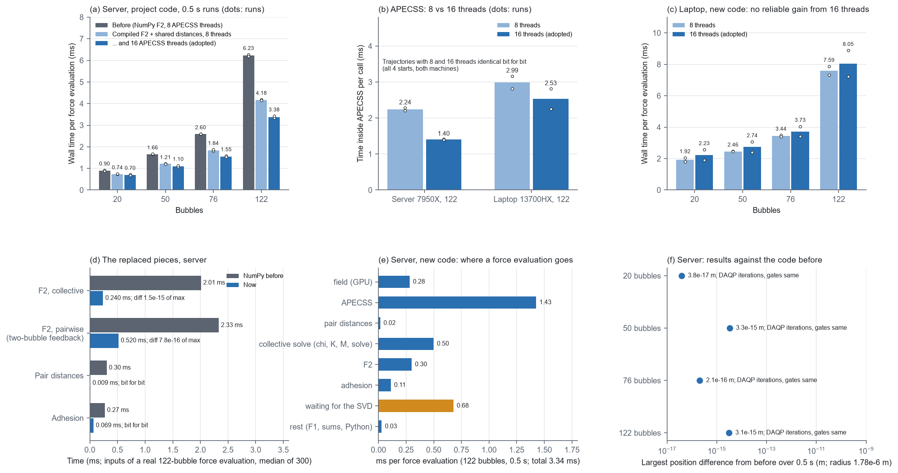

# F2 改成编译代码、共用泡间距离、APECSS 改 16 线程（2026-11-07）

> **状态（2026-11-09 核对）：** 现行。

用户决定（2026-11-07）：带传播延迟的 F2 改成编译代码；泡间距离只算一次、各处共用；APECSS 默认线程数由 8 改为 16。

`EXPLORATORY / PRETRAIN_TIER`

## 改了什么

**1. F2 改成编译代码**（`native/pair_forces.cpp` 的 `delayed_pair_forces`，`microbubble/forces.py` 的 `CompiledPairForces`）

- **取代的是什么**：取代原来的 NumPy 版 `forces._pair_forces_delayed`，原样保存在 `NUMPY_BEFORE.py.txt`。各项公式不变，包括：
  - 8 个谐波的传播延迟因子 g = e^(ikd)(1 − ikd)；
  - 全体耦合时基频项用 u；
  - 成对模式的双泡反馈；
  - 近场软核。
- **怎样计算**：C++ 按泡对逐一循环，不产生大临时数组。第 n 次谐波的 e^(inkd) 用 e^(ikd) 的 n 次方得到，每对只算一次余弦和正弦。
- **舍入差**：以下三处与 NumPy 版不同，结果差在末位。
  - 求和顺序；
  - e^(inkd) 改用 n 次方；
  - (d²+core²)^1.5 写成 t·√t。

  在真实输入上，与 NumPy 版相差不超过最大力的 1.5e-15。
- **不改的部分**：不带延迟的 F2（`pair_forces`，`propagation_delay: false` 时使用）仍是 NumPy。

**2. 泡间距离只算一次**（`pair_distances`，`CompiledPairForces.distances`）

- 每次力计算在编译库里算一次 n×n 距离矩阵 D，联立求解、F2、粘附力都用它。原来这三处各自用 NumPy 算一遍。
- 编译时不用乘加合成（不加 `-mfma`），运算顺序与 `np.linalg.norm(x[:, None] - x[None], axis=-1)` 相同，所以 D 和以前逐位相同。
- 粘附力改用 D 后，挑选泡对的顺序也和以前相同，结果逐位相同。

**3. APECSS 默认 16 线程**（`configs/pretrain_policy.json` 的 `apecss_response.threads`）

16 是服务器 7950X 的物理核数。运行配置的 `"apecss_threads"` 仍可改；结果与线程数无关。

**编译和缓存**：同接触库的做法（`forces.cached_pair_forces_library`）。按源码、编译器版本、编译选项（`-O3 -fPIC -shared`）只编译一次，缓存在 `build/pair_forces/`。运行时由 `workflows.f10ag.run` 编译，库路径传给 `CPUForces(pair_library=...)`，编译记录写进 `EXECUTION.json` 的 `identity.compiled_pair_forces`。

## 结果

**整条运行**（服务器，项目代码，4 个三维随机初态，1 ms，0.5 s，默认设置；每组两次）。"改动前"是 `evidence/collective_svd_overlap_20261107/` 改动后的两组运行，也就是这次改动之前的代码，8 线程（`data/F2_RUNS.json`，`fig1` (a)(f)）。

| 泡数 | 每次力计算：改动前 | F2 编译 + 共用距离（8 线程） | 再加 16 线程（采用） | 整条运行：改动前 → 采用 | 轨迹最大差 |
|---|---|---|---|---|---|
| 20 | 0.92 / 0.88 ms | 0.73 / 0.75 ms | 0.72 / 0.69 ms | 1.02 / 0.95 → 0.77 / 0.78 s | 3.8e-17 m |
| 50 | 1.65 / 1.67 ms | 1.22 / 1.20 ms | 1.06 / 1.14 ms | 1.11 / 1.11 → 0.83 / 0.89 s | 3.3e-15 m |
| 76 | 2.60 / 2.60 ms | 1.80 / 1.87 ms | 1.58 / 1.53 ms | 1.91 / 1.92 → 1.47 / 1.45 s | 2.1e-16 m |
| 122 | 6.27 / 6.20 ms | 4.19 / 4.16 ms | **3.33 / 3.42 ms** | 5.22 / 5.20 → **3.91 / 3.97 s** | 3.1e-15 m |

- 122 泡时，F2 编译加共用距离省 2.1 ms（事先估计 1.8–2.0 ms），16 线程再省 0.8 ms（事先估计 0.7 ms）。
- 轨迹差是舍入误差的大小（泡半径 1.78e-6 m），和接触库改用 AVX2/FMA 时的差一样大。
- 16 条新运行的 DAQP 迭代总数、质量门记录都和改动前相同；最小奇异值只在第 14 位以后不同。
- 同一台机器上，16 线程和 8 线程的轨迹逐位相同（4 个初态，服务器和笔记本都是）。

**被取代的几项**（服务器，122 泡第 250 次力计算的真实输入，各 300 次取中位数，`data/SUBSTEPS.json`，`fig1` (d)）：

| 项目 | NumPy（改动前） | 现在 | 结果 |
|---|---|---|---|
| F2，全体耦合 | 2.01 ms | 0.24 ms | 相差不超过最大力的 1.5e-15 |
| F2，成对模式（含双泡反馈） | 2.33 ms | 0.52 ms | 相差不超过最大力的 7.8e-16 |
| 泡间距离 | 0.30 ms | 0.009 ms | 逐位相同 |
| 粘附力 | 0.27 ms | 0.07 ms | 逐位相同 |

**APECSS 线程数**（122 泡，每次调用在 APECSS 里的时间，`fig1` (b)(c)）：
- **服务器**：8 线程 2.28 / 2.20 ms，16 线程 1.41 / 1.39 ms。
- **笔记本**（i7-13700HX：8 个性能核，各有两个硬件线程，另有 8 个能效核）：8 线程 2.81 / 3.17 ms，16 线程 2.25 / 2.81 ms。每次力计算的时间是 7.32 / 7.86 ms 对 7.22 / 8.87 ms。两次运行之间的波动比线程数造成的差别还大，看不出可靠的收益（`data/RUNS_laptop_*.json`）。

**现在一次力计算的时间花在哪里**（服务器，122 泡，0.5 s，每段单独计时，`data/BILL_122.json`，`fig1` (e)）：

| 部分 | 每次力计算 |
|---|---|
| 声场（GPU） | 0.28 ms |
| APECSS | 1.43 ms |
| 泡间距离 | 0.02 ms |
| 联立求解：χ、K、M、解方程 | 0.50 ms |
| F2 | 0.30 ms |
| 粘附力 | 0.11 ms |
| 等第二个线程上的最小奇异值 | 0.68 ms |
| 其余（F1、求和、Python） | 0.03 ms |
| 合计 | 3.34 ms |

- **最小奇异值成了最长的一支**：F2 变快以后，第二个线程上的最小奇异值检查（约 0.85 ms）比主线程同时要做的事长，主线程每次要等 0.68 ms。
- **等待比预计的长**：按分项估计只需等约 0.3 ms（检查约 0.85 ms，减去主线程同时要做的约 0.58 ms：解方程 0.14、F2 0.30、粘附力 0.11、其余 0.03）。原因后来查清（`evidence/svd_wait_20261107/`（2026-11-09 按用户要求删除））：第二个线程要等主线程解完方程、放开 Python 的全局锁才能开始（约 0.2 ms）；APECSS 的 OpenMP 线程结束后原地空转，检查本身也变慢约 0.15 ms。

**本机原型**（笔记本，合成的谐波，128 泡，`data/PROTOTYPE_VARIANTS_laptop.json`，`PROTO.py.txt`；当时 NumPy 版还在代码里）：
- 第一版 0.44 ms；改用 t·√t 后 0.35 ms；谐波求和改用实数运算后 0.30 ms，采用这一版。
- 每对的余弦和正弦约占 0.12 ms。

**测试：** 服务器 49/49 通过；笔记本 48/49，失败的仍是单层泡团文件的 AVX-512 末位差（改动前就失败）。`python main.py check` 两边都通过。新增测试 `test_compiled_distances_equal_numpy_distances`：编译库的距离必须与 `np.linalg.norm` 逐位相同。原有的三项物理测试改用编译版，都通过：
- 带延迟声场的数值梯度；
- k → 0 时回到瞬时形式，含双泡反馈；
- N = 2 时全体耦合等于带延迟的两泡闭式解。

## 文件

| 文件 | 内容 |
|---|---|
| `fig1_pair_forces_compiled.png` | (a) 服务器每次力计算；(b) APECSS 8/16 线程；(c) 笔记本每次力计算；(d) 被取代的几项；(e) 现在的分项；(f) 与改动前的轨迹差 |
| `data/F2_RUNS.json`、`data/RUNS_server_*.json` | 服务器整条运行，与改动前的比较（`RUNS_F2.py.txt`） |
| `data/RUNS_laptop_*.json` | 笔记本整条运行，8/16 线程 |
| `data/BILL_122.json` | 122 泡每次力计算的分项（`RUNS_F2.py.txt --bill`） |
| `data/SUBSTEPS.json` | 真实输入上编译版与 NumPy 版的比较（`SUBSTEPS.py.txt`） |
| `data/PROTOTYPE_VARIANTS_laptop.json` | 本机原型几种写法的耗时 |
| `NUMPY_BEFORE.py.txt` | 被取代的 NumPy 版 F2 和粘附力（原样） |
| `FIGURE_SCRIPT.py.txt` | 作图脚本 |

服务器上的运行：`/workspace/scratch/pair_forces_compiled_20261107/`。改动前被覆盖的 5 个文件备份在服务器的 `/workspace/scratch/backup_20261107_before_pair_forces/`。
