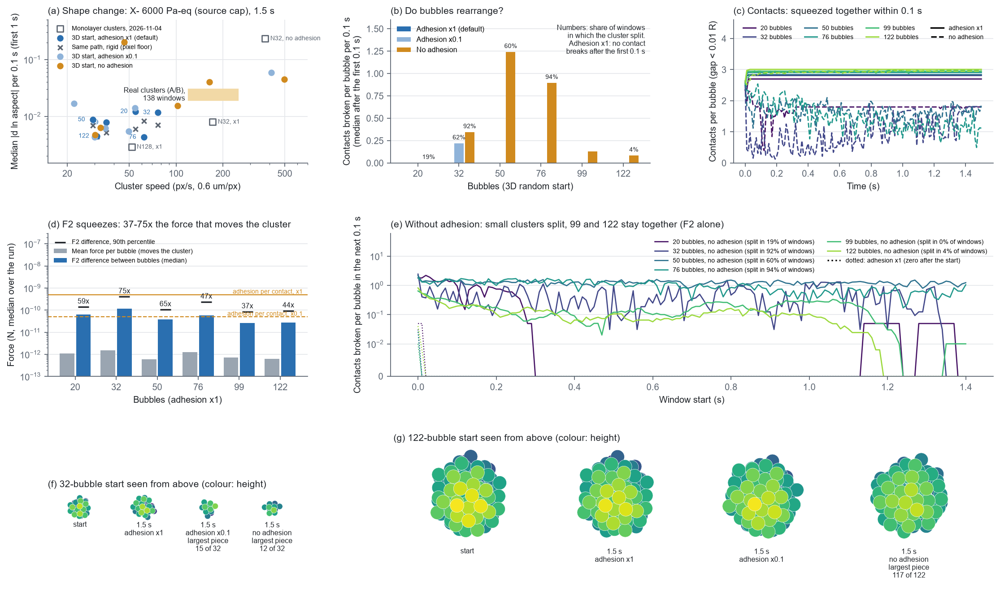

# 现在的三维泡团是否还偏硬、是什么卡住了它（2026-11-07）

> **状态（2026-11-09 核对）：** 历史。用当时的默认粘附 5.04e-10 N 做的诊断；之后据此核对了 F2（`evidence/f2_physics_check_20261107/`）、实施了泡的大小分布，2026-11-08 起默认改为弱粘附。

用户要求（2026-11-07）：在服务器上检查目前泡团计算时是否还偏硬，"卡住泡团的是声场开着时泡与泡之间的声学吸引，不是粘附"是否仍然成立，并生成必要的动画。

`EXPLORATORY / PHYSICS_UNCALIBRATED / PRETRAIN_TIER / PHENOMENOLOGICAL_ADHESION`；像素尺度 0.6 µm/px 为暂定值。

动画（从上往下看，颜色为高度，每 10 ms 一帧，放慢 4 倍；每个视频三格：默认粘附、0.1 倍、不加粘附）：`anim_seed14_N32.mp4`、`anim_seed16_N76.mp4`、`anim_seed7_N122.mp4`。

## 结论

1. **还是偏硬。** 默认粘附下，6 个三维泡团（20–122 泡）在开头 0.1 s 被挤紧以后，1.5 s 内一对接触也没有再断开。俯视的形状变化在像素噪声底的 0.5–2.1 倍之间，泡团只是整块平移和转动。
2. **把泡团挤紧、卡住的是泡间声学吸引 F2，不是粘附。**
   - 各泡之间的 F2 力差，是推动整团前进那部分力的 37–75 倍；2026-11-04 单层泡团时约 30 倍。
   - 开头 0.1 s 内，每泡接触数从 2.35–2.64 升到 2.7–3.0，几乎每对接触都受压。
   - 粘附降到 0.1 倍，6 个泡团里有 5 个照样一对接触都不断，结果和默认一样。
3. **和 2026-11-04 不同的一点：大泡团不靠粘附也不散。**
   - 不加粘附时，20–76 泡的泡团会碎（19–94% 的窗口在分裂）；
   - 99 泡和 122 泡的泡团单靠 F2 就留得住（分裂窗口 0% 和 4%），内部会换位（0.1 s 之后每泡每 0.1 s 断开 0.08–0.13 对接触；122 泡在 1.5 s 里断开过 202 对开头的接触），但俯视外形仍是圆的，形状变化仍在噪声底附近。
   - 2026-11-04 的"泡间声学吸引单独留不住团，是粘附把团留住的"，现在只对 76 泡及以下的三维泡团成立。
4. **团速对不上真实泡团。** 在声源上限（单路 X− 6000 Pa-eq）下，没散开的三维泡团只走 22–77 px/s。2026-11-04 的单层 32 泡团是 172 px/s，真实对照窗口是 120–250 px/s。所以这次做不到"团速相当"的直接比较：判断偏硬，依据的是每次运行自己的像素噪声底，以及接触有没有断开。

## 怎么测的

- **服务器**：AMD Ryzen 9 7950X，RTX 4090。项目代码不改（`SOFT3D_RUNS.py.txt`），默认设置即
  - 全体耦合带传播延迟、APECSS、GPU 声场、C++ 接触步、1 ms 固定步长；
  - 三维随机初态，`random_start` 的 seed 23、14、21、16、17、7，对应 20、32、50、76、99、122 泡。
- **驱动**：照 `evidence/softness_matched_speed_20261104/`（2026-11-09 按用户要求删除），单路 X−、6000 Pa-eq（声源上限）、2.5 MHz，持续 1.5 s。只在测量进程里替换了运行的驱动动作（`microbubble.control.random_actions`）。
- **粘附**：默认（每对接触最大 5.0e-10 N）、0.1 倍、0，用配置项 `adhesion_coefficient_N_per_Pa2` 设。18 条运行全部 PASS，没有一条中途停下。
- **形状指标**：与 2026-11-04 相同（`visualization/ab_protocol_figures.py`，`ANALYSE.py.txt`）。
  - 位置每 1 ms 存一帧，线性插值到相机的 60 帧/秒；
  - 从上往下看，按 0.6 µm/px 把泡画成半径 R 的圆盘，三维泡团就是投影剪影；
  - 取开启后 1 s 内的 0.1 s 窗口，量主团 |Δ ln 长宽比| 的中位数；
  - 像素噪声底：同一个初始泡团完全不变形，沿这条运行的质心路径整体平移，再用同样的方法量。
- **接触**：间隙小于 0.01R 的泡对，每 10 ms 一帧；每个 0.1 s 窗口里，开头接触、结尾已分开的对数，按泡数平均。
- **力**：每次力计算记下
  - 推动整团的力：各泡合力的平均值；
  - 各泡之间的力差：每个泡的 F2 减去 F2 平均值后的大小，取中位数和 90% 分位；
  - 两者都取整条运行的中位数。

## 结果

| 泡数 | 粘附 | 团速 px/s | 每 0.1 s 形状变化 | 像素噪声底 | 分裂窗口 | 每泡接触数：开始 → 1.5 s | 0.1 s 之后每泡每 0.1 s 断开的接触 | F2 力差 / 推动整团的力 |
|---|---|---|---|---|---|---|---|---|
| 20 | 默认 | 55 | 0.0122 | 0.0059 | 0% | 2.35 → 2.70 | 0.00 | 59 倍 |
| 20 | 0.1 倍 | 54 | 0.0140 | 0.0083 | 0% | 2.35 → 2.70 | 0.00 | 57 倍 |
| 20 | 无 | 102 | 0.0155 | 0.0167 | 19% | 2.35 → 1.80 | 0.00 | 24 倍 |
| 32 | 默认 | 77 | 0.0117 | 0.0070 | 0% | 2.50 → 2.81 | 0.00 | 75 倍 |
| 32 | 0.1 倍 | 409 | 0.0590 | 0.0111 | 62% | 2.50 → 2.03 | 0.22 | 14 倍 |
| 32 | 无 | 496 | 0.0445 | 0.0060 | 92% | 2.50 → 1.81 | 0.34 | 14 倍 |
| 50 | 默认 | 29 | 0.0087 | 0.0068 | 0% | 2.64 → 2.84 | 0.00 | 65 倍 |
| 50 | 0.1 倍 | 22 | 0.0168 | 0.0056 | 0% | 2.64 → 3.00 | 0.00 | 49 倍 |
| 50 | 无 | 46 | 0.2018 | 0.0077 | 60% | 2.64 → 1.84 | 1.24 | 17 倍 |
| 76 | 默认 | 62 | 0.0043 | 0.0083 | 0% | 2.58 → 2.91 | 0.00 | 47 倍 |
| 76 | 0.1 倍 | 50 | 0.0054 | 0.0067 | 0% | 2.58 → 2.95 | 0.00 | 63 倍 |
| 76 | 无 | 164 | 0.0399 | 0.0062 | 94% | 2.58 → 1.12 | 0.89 | 12 倍 |
| 99 | 默认 | 36 | 0.0078 | 0.0051 | 0% | 2.54 → 2.95 | 0.00 | 37 倍 |
| 99 | 0.1 倍 | 35 | 0.0061 | 0.0056 | 0% | 2.54 → 2.98 | 0.00 | 36 倍 |
| 99 | 无 | 33 | 0.0063 | 0.0041 | 0% | 2.54 → 2.98 | 0.13 | 38 倍 |
| 122 | 默认 | 31 | 0.0045 | 0.0044 | 0% | 2.61 → 3.01 | 0.00 | 44 倍 |
| 122 | 0.1 倍 | 30 | 0.0043 | 0.0039 | 0% | 2.61 → 3.01 | 0.00 | 43 倍 |
| 122 | 无 | 30 | 0.0047 | 0.0027 | 4% | 2.61 → 2.95 | 0.08 | 16 倍 |

真实对照（`evidence/softness_matched_speed_20261104/`（2026-11-09 按用户要求删除））：120–250 px/s 的 138 个窗口，每 0.1 s 形状变化 0.024。2026-11-04 单层泡团，默认粘附：32 泡 172 px/s 时 0.0079（噪声底 0.0028），128 泡 52 px/s 时 0.0029（噪声底 0.0023）。

各泡之间的 F2 力差（默认粘附）中位数为 2.7e-11 到 1.2e-10 N，90% 分位为 8.7e-11 到 4.1e-10 N，都低于每对接触的粘附力 5.0e-10 N。降到 0.1 倍时粘附力是 5.0e-11 N，与 F2 力差相当，只有 32 泡的泡团被拉开（`anim_seed14_N32.mp4`：0.75 s 时被拉成一串、碎成 7 块）。

## 没有回答的

- **团速相当时的直接比较**：在声源上限内，三维泡团达不到真实泡团的团速。真实泡团在 20–80 px/s 时的形状变化没有存下来，这次没有去重算，因为它要读另一个项目里的 A/B 追踪数据。
- **更长时间**：只跑了 1.5 s。不加粘附的大泡团在内部换位，更长时间里会不会变形或散开，没有测。

## 文件

| 文件 | 内容 |
|---|---|
| `fig1_soft3d.png` | (a) 形状变化对团速；(b) 0.1 s 之后断开的接触；(c) 每泡接触数随时间；(d) F2 力差与推动整团的力；(e) 不加粘附时断开的接触随时间；(f)(g) 32 泡和 122 泡的俯视图（开始、1.5 s） |
| `anim_seed14_N32.mp4`、`anim_seed16_N76.mp4`、`anim_seed7_N122.mp4` | 动画（`ANIMATION_SCRIPT.py.txt`） |
| `data/RUNS.json` | 18 条运行的概要（状态、泡数、粘附力、初态） |
| `data/ANALYSIS.json` | 形状、噪声底、接触、力的统计（`ANALYSE.py.txt`） |
| `data/SERIES.json` | 每 10 ms 的每泡接触数和断开数（`FIGURE_SCRIPT.py.txt`） |
| `SOFT3D_RUNS.py.txt`、`ANALYSE.py.txt`、`FIGURE_SCRIPT.py.txt`、`ANIMATION_SCRIPT.py.txt` | 运行、分析、作图、动画脚本 |

运行输出和紧凑数据（相机帧、每 10 ms 位置、每步的力和接触数）在服务器的 `/workspace/scratch/soft3d_20261107/out/`（每条运行的 `run/` 和 `compact.npz`）。

## 后续（2026-11-07）

驻波节点检验（`evidence/node_test_20261107/`）：把声压节点放在泡团中心时，F2 力差降到波腹处的 1/16–1/87，泡团在默认粘附下仍一整块不动，这时卡住泡团的是粘附（是节点处 F2 力差的 50–750 倍）。上面“卡住泡团的是 F2，不是粘附”只对声压高的地方（单路行波、波腹）成立。
