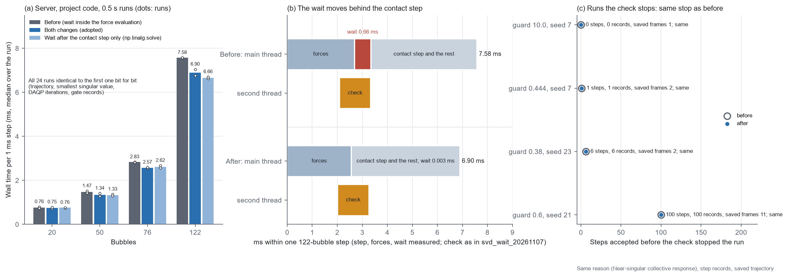

# 最小奇异值检查：第二个线程立即开始，等结果推迟到接触步之后（2026-11-07）

> **状态（2026-11-09 核对）：** 现行（推迟等结果）。改法 1（`lapack_solve`）同日已去掉（`evidence/time_bill_now_20261107/`）。

用户决定（2026-11-07）：采用 `evidence/svd_wait_20261107/`（2026-11-09 按用户要求删除） 的两种改法，即让第二个线程立即开始，以及把等检查结果推迟到接触步之后，并做测试和验证。

`EXPLORATORY / PRETRAIN_TIER`

> 后续（2026-11-07，用户决定）：改法 1（`lapack_solve`）同日去掉，方程改回 `np.linalg.solve`；推迟以后它没有可测的收益（下面"只推迟"一组就是去掉后的代码）。现在的耗时见 `evidence/time_bill_now_20261107/`。

## 改了什么

**1. 第二个线程立即开始**（`microbubble/forces.py` 的 `lapack_solve`）

- **原来**：联立求解的方程 M·u = χP 用 `np.linalg.solve` 求解，它计算期间不放开 Python 的全局锁，第二个线程要等主线程解完方程（约 0.2 ms）才能开始检查。
- **现在**：经 ctypes 调用 `np.linalg.solve` 用的同一个 LAPACK 函数 `zgesv`（NumPy 自带的 OpenBLAS 里，M 同样按列存放），结果逐位相同，计算期间放开全局锁。

**2. 等检查结果推迟到接触步之后**（`CPUForces.wait_for_singular_value_check`，`microbubble/integration.py`）

- **原来**：`CPUForces.__call__` 在交出力之前等检查结果，122 泡时主线程每次约等 0.66 ms。
- **现在**：
  - `CPUForces.__call__` 把检查留在第二个线程上，先交出力；
  - 积分循环紧接在接触步之后、记录这一步和其余检查之前，调用 `forces.wait_for_singular_value_check()`；
  - 检查在接触步计算的同时算完（122 泡时接触步约 4 ms，检查约 1.25 ms）。
- **停止规则不变**：
  - 检查不通过时，在 `wait_for_singular_value_check()` 处报同样的错（"Near-singular collective response; no regularization"）；
  - 这一步不记录、不接受，运行停在上一个已接受的状态。
- **和原来的区别**：
  - 不通过的那一步会先白算一次接触步；
  - `exception.txt` 里调用链的外层是积分循环，不再是 `CPUForces.__call__`。
- **为什么停止原因不会变**：接触步只在力不是有限数，或者位置、设置不合法时才自己报错。被检查拦下的力虽然很大，仍是有限数，所以接触步不会抢先以别的原因停下运行。
- **调用约定**：集体耦合时，`__call__` 交出的力还没通过检查，用它推动泡之前必须先调用 `wait_for_singular_value_check()`（写在 `CPUForces` 的说明里）。项目里只有积分循环用力来推动泡。

## 结果

**整条运行**（服务器，项目代码，4 个三维随机初态，1 ms，0.5 s，默认设置；每组两次；`data/DEFER_RUNS.json`，`fig1` (a)(b)）。每步耗时是相邻两次力计算开始的间隔，取整条运行的中位数，包括力、接触步和等待。

| 泡数 | 每步：改动前 | 两项都改（采用） | 只推迟（解方程仍用 `np.linalg.solve`） |
|---|---|---|---|
| 20 | 0.79 / 0.72 ms | 0.72 / 0.78 ms | 0.75 / 0.76 ms |
| 50 | 1.52 / 1.43 ms | 1.28 / 1.41 ms | 1.37 / 1.29 ms |
| 76 | 2.84 / 2.82 ms | 2.56 / 2.59 ms | 2.57 / 2.67 ms |
| 122 | 7.58 / 7.58 ms | **7.05 / 6.75 ms** | 6.62 / 6.70 ms |

- **结果逐位相同**：24 条运行的轨迹、最小奇异值、DAQP 迭代总数、质量门记录、轨迹文件的 SHA-256 全部相同。
- **等待基本消失**：主线程每步等检查的时间从约 0.66 ms（122 泡，`evidence/svd_wait_20261107/`（2026-11-09 按用户要求删除））降到 0.002–0.003 ms（各泡数）。
- **整条运行**：122 泡 3.94 / 3.91 s → 3.64 / 3.56 s。
- **改法 1 没有可测的额外收益**："只推迟"一组与"两项都改"相同，差别在两次运行的波动之内。推迟以后，检查有一整个接触步的时间可以算完，早开始 0.2 ms 已经不起作用。改法 1 只可能在接触步很短的步里起作用，比如几乎没有接触、而泡数又多的时候，这 4 个初态里没有遇到。

**检查不通过时停在同一步**（`data/GUARD_before.json`、`data/GUARD_after.json`，`fig1` (c)）

把 `singular_guard` 临时调高，让检查一定会在某一步不通过。阈值按每步的最小奇异值序列选（`data/SIGMA_SERIES.json`）：

| 阈值、初态 | 改动前停在 | 改动后停在 | 步记录 | 保存的帧数 | 其余 |
|---|---|---|---|---|---|
| 10，seed 7（122 泡） | 第 0 步 | 第 0 步 | 0 / 0 | 1 / 1 | 相同 |
| 0.4440，seed 7 | 第 1 步 | 第 1 步 | 1 / 1 | 2 / 2 | 相同 |
| 0.38，seed 23（20 泡） | 第 6 步 | 第 6 步 | 6 / 6 | 2 / 2 | 相同 |
| 0.6，seed 21（50 泡） | 第 100 步 | 第 100 步 | 100 / 100 | 11 / 11 | 相同 |

"其余"包括停止原因、保存轨迹的校验值和位置、`exception.txt` 的最后一行。第一次选的阈值（seed 7 用 0.45，seed 16 用 0.40）在改动前的代码上都停在第 0 步，因为这两个初态的最小奇异值在开头就最低（`data/GUARD_before_first_try.json`），所以改按序列选了上面的四个阈值。

**测试：** 服务器 51/51 通过；笔记本 50/51，失败的仍是单层泡团文件的 AVX-512 末位差（改动前就失败）。`python main.py check` 两边都通过。新增两项测试：
- `test_collective_solve_equals_numpy_solve`：`lapack_solve` 与 `np.linalg.solve` 逐位相同；
- `test_forces_are_handed_out_before_the_singular_value_check`：阈值 10 时力照常交出，在 `wait_for_singular_value_check()` 处报错。

## 文件

| 文件 | 内容 |
|---|---|
| `fig1_svd_defer.png` | (a) 每步耗时；(b) 122 泡一步的时间安排，改动前后；(c) 检查不通过的运行停在哪一步 |
| `data/DEFER_RUNS.json`、`data/RUNS_{before,after,deferonly}_{1,2}.json` | 整条运行的比较（`RUNS_DEFER.py.txt`） |
| `data/GUARD_before.json`、`data/GUARD_after.json`、`data/GUARD_before_first_try.json` | 检查不通过的运行（`RUNS_DEFER.py.txt --guard`；first_try 是第一次选的阈值，只在改动前的代码上跑过） |
| `data/SIGMA_SERIES.json` | 每步最小奇异值序列的概要，用来选阈值（`SIGMA_SERIES.py.txt`） |
| `FIGURE_SCRIPT.py.txt` | 作图脚本 |

服务器上的运行：`/workspace/scratch/svd_defer_20261107/`。改动前被覆盖的 3 个文件备份在服务器的 `/workspace/scratch/backup_20261107_before_svd_defer/`。
