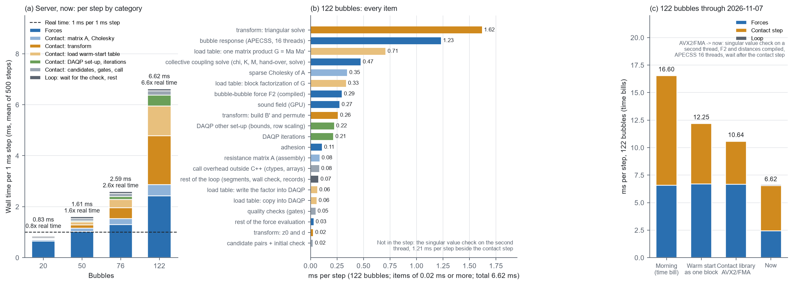

# 现在每一步的耗时账单（2026-11-07 晚）

> **状态（2026-11-09 核对）：** 现行（Y 形芯片之前、旧芯片上的测量）。2026-11-09 在 Y 形芯片上的剖析：每步约 70% 的时间用在最小奇异值检查（`evidence/y_channel_chip_20261109/`）。

用户要求（2026-11-07）：去掉"让第二个线程立即开始"（`lapack_solve`），并对目前的计算用时进行统计。

`EXPLORATORY / PRETRAIN_TIER`

## 去掉"立即开始"

- **改了什么**：联立求解的方程改回 `np.linalg.solve`。`microbubble/forces.py` 里的 `lapack_solve` 和 `zgesv` 的绑定已删除，测试 `test_collective_solve_equals_numpy_solve` 一并删除。
- **为什么去掉**：推迟等待以后，它没有可测的收益（`evidence/svd_defer_20261107/`）。
- **保留的部分**：最小奇异值检查仍在第二个线程上算，积分循环在接触步之后才取结果。
- **验证**：
  - 测试：服务器 50/50 通过；笔记本 49/50，失败的仍是单层泡团文件的 AVX-512 末位差（改动前就失败）。`python main.py check` 两边都通过。
  - 4 个初态的整条运行（`data/RUNS_after_removing_lapack_solve.json`）：轨迹、最小奇异值、DAQP 迭代总数、质量门记录、轨迹 SHA-256 都与改动前（`evidence/svd_defer_20261107/` 的 before_1）逐位相同。

## "实时"的含义

固定步长 1 ms，每一步代表 1 ms 的物理时间。要实时（算 1 s 只花 1 s），每一步必须在 1 ms 内算完。下面都按"每步多少毫秒"记。

## 怎么测的

口径与 `evidence/time_bill_20261107/`（2026-11-09 按用户要求删除） 相同。

- **机器**：服务器（AMD Ryzen 9 7950X，RTX 4090），每条运行单独跑。
- **运行**：4 个三维随机初态（20、50、76、122 泡），随机动作，0.5 s（500 步），项目默认设置（GPU 声场、APECSS 16 线程、F2 和泡间距离用编译库、C++ 接触步、DAQP 最小距离形式且热启动整块装入、检查在第二个线程上且在接触步之后取结果）。账单是 500 步的平均。
- **C++ 部分**：用带计时的接触库副本。源码就是 `evidence/time_bill_20261107/timed_sources/contact_step_bill.cpp.txt`（2026-11-09 按用户要求删除）、`evidence/daqp_block_warm_start_20261107/timed_sources/daqp_qp_bill.cpp.txt`，以及打了 `daqp_utils_c_timing.diff.txt` 的 DAQP 源码；与现在的 `native/` 相比只多了计时语句。按项目的接触库编译选项（`-O3 -mavx2 -mfma`）重新编译成单独的临时库（`TIMED_LIBRARY_BUILD_COMMAND.txt`），项目代码没有改动。
- **Python 部分**：给算力各项、接触步调用、等检查和整个循环套上计时（`BILL_NOW.py.txt`）。
- **核对**：
  - 计时库算出的轨迹与正常运行逐位相同；
  - 各项加起来与直接量的整个循环一致（122 泡 6.625 对 6.628 ms/步）；
  - 122 泡重跑一次是 6.596 ms/步（`data/bill_seed7_repeat.json`）。

## 按类别（每步 ms）

| 类别 | 20 泡 | 50 泡 | 76 泡 | 122 泡 |
|---|---|---|---|---|
| 算力 | 0.65（78%） | 1.03（64%） | 1.30（50%） | 2.42（37%） |
| 接触：阻力矩阵与分解 | 0.04（5%） | 0.13（8%） | 0.22（9%） | 0.45（7%） |
| 接触：变换（主要是三角求解） | 0.02（2%） | 0.12（7%） | 0.44（17%） | 1.91（29%） |
| 接触：装热启动表 | 0.02（2%） | 0.12（7%） | 0.32（12%） | 1.16（18%） |
| 接触：DAQP 准备和迭代 | 0.01（1%） | 0.04（3%） | 0.11（4%） | 0.44（7%） |
| 接触：候选、质量门、调用开销 | 0.04（4%） | 0.09（6%） | 0.11（4%） | 0.16（2%） |
| 循环：等检查、其余 | 0.06（7%） | 0.07（4%） | 0.08（3%） | 0.08（1%） |
| **每步合计** | **0.83 ms** | **1.61 ms** | **2.59 ms** | **6.62 ms** |
| **与实时相比** | **快约 1.2 倍** | **慢 1.6 倍** | **慢 2.6 倍** | **慢 6.6 倍** |

整条 0.5 s 运行用时 0.77 / 1.11 / 1.63 / 3.65 s，其中开始前的准备约 0.3 s（编译缓存查找、APECSS 和 GPU 初始化），结束后约 0.04 s。

## 明细（每步 ms）

| 类别 | 项目 | 20 泡 | 50 泡 | 76 泡 | 122 泡 |
|---|---|---|---|---|---|
| 算力 | 声场（GPU） | 0.259 | 0.257 | 0.257 | 0.273 |
| 算力 | 气泡响应 APECSS（16 线程） | 0.243 | 0.510 | 0.609 | 1.230 |
| 算力 | 泡间距离（编译） | 0.004 | 0.006 | 0.008 | 0.015 |
| 算力 | 联立求解（χ、K、M、交出检查、解方程） | 0.050 | 0.113 | 0.194 | 0.473 |
| 算力 | 泡间力 F2（编译） | 0.024 | 0.060 | 0.122 | 0.295 |
| 算力 | 粘附 | 0.045 | 0.058 | 0.076 | 0.108 |
| 算力 | 其余（组合声压、F1、合力） | 0.030 | 0.023 | 0.039 | 0.029 |
| 接触：阻力矩阵 | 组装阻力矩阵 A | 0.012 | 0.033 | 0.052 | 0.085 |
| 接触：阻力矩阵 | A 的稀疏 Cholesky 分解 | 0.030 | 0.094 | 0.162 | 0.346 |
| 接触：阻力矩阵 | 自由位移 | 0.002 | 0.005 | 0.009 | 0.017 |
| 接触：其他 | 找候选泡对、初始检查 | 0.002 | 0.006 | 0.009 | 0.021 |
| 接触：其他 | 线性化约束 | 0.001 | 0.002 | 0.003 | 0.007 |
| 接触：变换 | 建 Bᵀ 并重排 | 0.002 | 0.015 | 0.066 | 0.259 |
| 接触：变换 | 稀疏三角求解 | 0.014 | 0.098 | 0.357 | 1.617 |
| 接触：变换 | 算 z0 和 d | 0.001 | 0.004 | 0.007 | 0.024 |
| 接触：装表 | 准备热启动猜测 | 0.000 | 0.001 | 0.001 | 0.001 |
| 接触：装表 | 数据拷给 DAQP | 0.001 | 0.004 | 0.012 | 0.057 |
| 接触：装表 | DAQP 逐个加入热启动约束（已不用） | 0.000 | 0.000 | 0.000 | 0.000 |
| 接触：装表 | 一次矩阵乘法 G = M_A·M_Aᵀ | 0.006 | 0.056 | 0.178 | 0.707 |
| 接触：装表 | G 的整块分解 | 0.007 | 0.046 | 0.109 | 0.334 |
| 接触：装表 | 把分解写进 DAQP | 0.001 | 0.009 | 0.024 | 0.063 |
| 接触：DAQP | DAQP 其余准备（边界、行缩放） | 0.004 | 0.025 | 0.061 | 0.222 |
| 接触：DAQP | DAQP 迭代 | 0.003 | 0.019 | 0.049 | 0.215 |
| 接触：DAQP | DAQP 释放内存 | 0.000 | 0.001 | 0.001 | 0.001 |
| 接触：变换 | 变换回 s、输出贴紧泡对 | 0.001 | 0.003 | 0.005 | 0.011 |
| 接触：其他 | 各道质量门 | 0.005 | 0.015 | 0.024 | 0.047 |
| 接触：其他 | 候选覆盖检查 | 0.000 | 0.002 | 0.004 | 0.009 |
| 接触：其他 | 调用 C++ 的开销（ctypes、数组） | 0.029 | 0.069 | 0.074 | 0.081 |
| 循环 | 接触步之后等最小奇异值检查 | 0.002 | 0.002 | 0.013 | 0.003 |
| 循环 | 其余（分段、管壁检查、记录） | 0.057 | 0.070 | 0.069 | 0.074 |
| **合计** | | **0.834** | **1.606** | **2.593** | **6.625** |
| 不计入：第二个线程上的最小奇异值检查 | | 0.045 | 0.187 | 0.431 | 1.207 |

最小奇异值检查在第二个线程上算（122 泡每步 1.21 ms），与接触步同时进行；主线程等它的时间计在"接触步之后等最小奇异值检查"里（0.003 ms）。

## 122 泡：这一天的变化

同一口径的账单（`fig1` (c)）：

| | 算力 | 接触步 | 循环 | 每步合计 |
|---|---|---|---|---|
| 上午耗时账单（`evidence/time_bill_20261107/`（2026-11-09 按用户要求删除）） | 6.56 ms | 9.97 ms | 0.07 ms | 16.60 ms |
| 热启动整块装入（`evidence/daqp_block_warm_start_20261107/`） | 6.69 ms | 5.49 ms | 0.07 ms | 12.25 ms |
| 接触库 AVX2/FMA（`evidence/contact_avx2_fma_20261107/`） | 6.66 ms | 3.91 ms | 0.07 ms | 10.64 ms |
| 现在 | 2.42 ms | 4.12 ms | 0.08 ms | **6.62 ms** |

最后一行之前，还依次做了这几项改动，各自没有单独的账单：

- 检查放到第二个线程（`evidence/collective_svd_overlap_20261107/`）；
- F2 和泡间距离用编译库、APECSS 改 16 线程（`evidence/pair_forces_compiled_20261107/`）；
- 等检查推迟到接触步之后（`evidence/svd_defer_20261107/`）。

**接触步比 AVX2/FMA 那次的账单多约 0.2 ms**（两次运行 +0.22、+0.18 ms）。接触步的代码没有变。多出的时间分散在稀疏分解、建 Bᵀ、三角求解这几项访存多的计算上，另有约 0.04 ms 在调用开销里。可能的原因是：检查现在和接触步同时在另一个核上算，或者 16 个 APECSS 线程结束后原地空转，挤占了共享缓存或频率。这一点没有验证。

## 现在最大的几项（122 泡）

1. 稀疏三角求解 1.62 ms：接触步把约束变换成最小距离形式时用到。
2. APECSS 1.23 ms：16 线程。
3. 装表时的矩阵乘法 G = M_A·M_Aᵀ 0.71 ms。
4. 联立求解 0.47 ms：其中建 K、M 约 0.2 ms，解方程约 0.14 ms。
5. A 的稀疏分解 0.35 ms，G 的整块分解 0.33 ms，F2 0.30 ms，声场 0.27 ms。

接触步合计 4.12 ms，占 122 泡每步的 62%。

## 文件

| 文件 | 内容 |
|---|---|
| `fig1_time_bill_now.png` | (a) 每步按类别；(b) 122 泡逐项；(c) 122 泡这一天的变化 |
| `data/bill_seed{23,21,16,7}.json`、`data/bill_seed7_repeat.json` | 账单（`BILL_NOW.py.txt`） |
| `data/RUNS_after_removing_lapack_solve.json` | 去掉 `lapack_solve` 后的整条运行（`evidence/svd_defer_20261107/RUNS_DEFER.py.txt`） |
| `TIMED_LIBRARY_BUILD_COMMAND.txt` | 计时库的编译命令 |
| `FIGURE_SCRIPT.py.txt` | 作图脚本 |

服务器上的文件：`/workspace/scratch/time_bill_now_20261107/`。去掉 `lapack_solve` 前被覆盖的 2 个文件备份在服务器的 `/workspace/scratch/backup_20261107_before_removing_lapack_solve/`。
